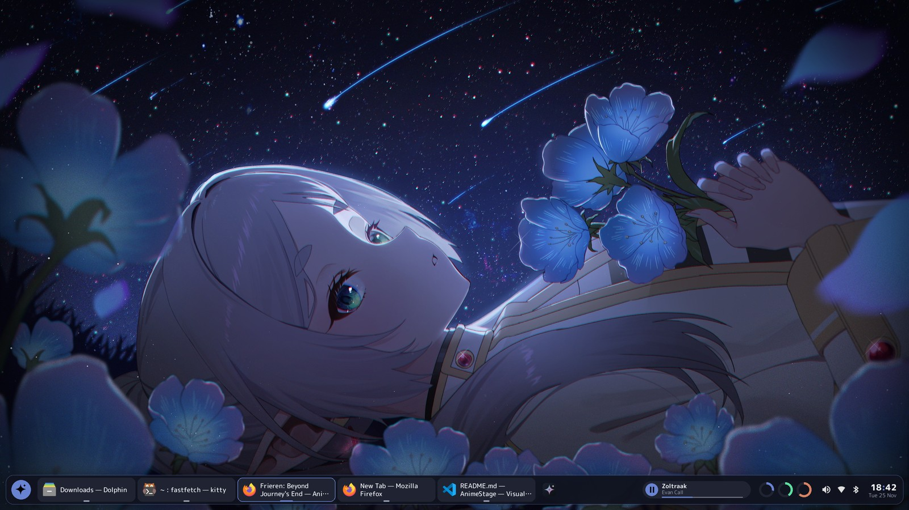
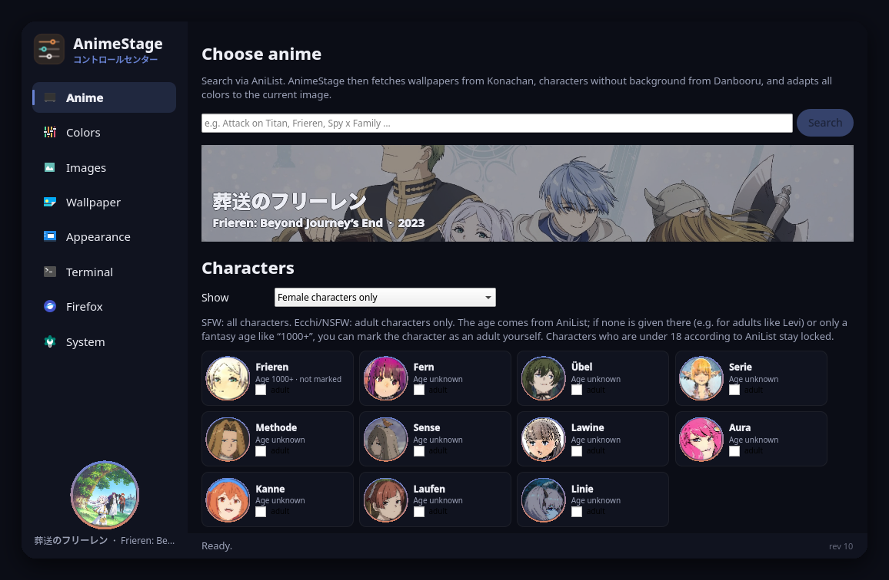

# AnimeStage

**Trasforma il tuo desktop KDE Plasma 6 nel tuo anime preferito.**
Scrivi un anime – AnimeStage costruisce tutto il desktop intorno: sfondi che cambiano, colori abbinati ovunque, personaggi nel menu di avvio, terminale, Firefox e VS Code a tema.

🌐 [English](../README.md) · [Deutsch](README.de.md) · [日本語](README.ja.md) · [Français](README.fr.md) · [Español](README.es.md) · [Português (BR)](README.pt_BR.md) · **Italiano** · [Polski](README.pl.md) · [Nederlands](README.nl.md) · [Русский](README.ru.md) · [简体中文](README.zh_CN.md) · [繁體中文](README.zh_TW.md) · [한국어](README.ko.md)



## Funzioni

- **Qualsiasi anime** – ricerca tramite AniList; titolo, banner e personaggi (con età) arrivano in automatico.
- **Sfondi che cambiano** – nuove immagini da Konachan ogni 2 ore (regolabile), per personaggio, filtro e atmosfera. Salva i preferiti o scarta le immagini.
- **I colori seguono lo sfondo** – i colori d'accento di ogni nuova immagine vengono applicati a Plasma, decorazioni delle finestre, icone (cartelle Papirus), terminale, Firefox e VS Code.
- **Pannello in stile anime** – menu di avvio con lo scontorno di un personaggio, gestore attività con i titoli delle finestre, pillola musicale, anelli CPU/RAM/GPU e calendario.
- **Terminale** – kitty o Konsole nei colori del tema, saluto con un'immagine nuova + info di sistema, prompt Starship e, se vuoi, un'immagine come sfondo del terminale.
- **Firefox** – schede e barra degli indirizzi abbinate, più un'immagine nella nuova scheda che cambia a ogni avvio.
- **Schermata di blocco e di accesso** mostrano anche il tuo sfondo (accesso: Plasma Login Manager).
- **Centro di controllo** – tutto in una finestra, senza modificare file di configurazione.
- **13 lingue** – segue la lingua di sistema, modificabile nel Centro di controllo.

### Barra delle applicazioni come su Windows


Ogni finestra ha la sua voce con il titolo accanto all'icona: due finestre di Firefox sono due voci. Le app fissate restano dove le hai messe e le loro finestre si aprono proprio lì. In **Centro di controllo → Aspetto → Gestore attività** puoi nascondere i titoli, raggruppare le finestre o scegliere la larghezza (stretta / media / larga).

### Sfondi e colori


Ogni nuovo sfondo porta i suoi colori: AnimeStage ricava dall'immagine i colori d'accento e di sfondo e ricolora pannello, finestre, icone, terminale, Firefox e VS Code – automaticamente ogni 2 ore. Il pannello in basso in ogni immagine mostra i colori di quell'immagine.

### Menu di avvio, calendario e carico di sistema


| Centro di controllo – anime e personaggi | Centro di controllo – sfondo |
|---|---|
|  |  |

## Requisiti

- **KDE Plasma 6** (creato e testato su Bazzite / Fedora Atomic con Plasma 6.8; altre distribuzioni con Plasma 6 dovrebbero funzionare)
- Python 3 con **Pillow** (`python3-pillow`)
- Una connessione a Internet (AniList, Konachan, Danbooru)
- Facoltativo: kitty (installato in automatico su richiesta), Homebrew per Starship/eza/bat/zoxide, Kvantum

Tutto viene installato nel tuo profilo utente – **non servono permessi di root**. Solo lo sfondo della schermata di accesso chiede una volta la password.

## Installazione

**Il modo semplice (consigliato):**

1. Scarica **AnimeStage.zip** dall'[ultima versione](https://github.com/propanisen/AnimeStage/releases/latest).
2. Estrailo (clic destro → *Estrai qui*).
3. Fai doppio clic su **Installa AnimeStage** nella cartella e segui le finestre: lingua, pannello, anime – fatto.

**Una riga nel terminale:**

```bash
curl -fsSL https://github.com/propanisen/AnimeStage/releases/latest/download/get.sh | bash
```

**Con git (per sviluppatori):**

```bash
git clone https://github.com/propanisen/AnimeStage.git
cd AnimeStage
./install.sh --plan          # mostra cosa succederà (non cambia nulla)
./install.sh                 # installa (prima viene fatto un backup delle impostazioni KDE)
```

Opzioni:

```bash
./install.sh --anime "Frieren"   # inizia subito con un anime
./install.sh --lang it           # lingua dell'installazione e del tema
./install.sh --profile core      # mantieni il pannello attuale
```

Poi apri **Menu di avvio → Centro di controllo AnimeStage → Anime** e cerca il tuo anime.

### Aggiornamento

AnimeStage controlla una volta al giorno su GitHub se c'è una nuova versione e mostra una notifica. Installala con un clic in **Centro di controllo → Sistema → Updates** (oppure `animestage update install`). La notifica ha un pulsante **Installa ora** – oppure lascia che gli aggiornamenti si installino da soli (impostazione nello stesso punto). Prima di ogni aggiornamento viene creato un backup. Non vuoi il controllo? Togli la spunta lì o esegui `animestage update off`.

Aggiornare a mano da un clone git:

```bash
git pull
./update.sh          # impostazioni, preferiti e pannello restano come sono
```

### Disinstallazione

**Il modo semplice:** Centro di controllo → Sistema → **Disinstalla AnimeStage …** – una finestra chiede conferma e ripristina tutto.

**Nel terminale:**

```bash
./uninstall.sh            # rimuove tutto e ripristina le impostazioni KDE originali
./uninstall.sh --purge    # elimina anche le immagini scaricate e la configurazione
```

**Cosa succede durante installazione e disinstallazione:** prima di modificare qualsiasi cosa, l'installer salva le tue impostazioni KDE (pannello, colori, decorazione delle finestre, caratteri, schermata di blocco, schermata di avvio …) in `~/.local/state/animestage/backups/original`. La disinstallazione rimuove tutti i file e i timer di AnimeStage, annulla le modifiche a terminale, Firefox, VS Code e schermata di accesso, e poi ripristina quel backup: il desktop torna esattamente com'era. Anche le modifiche al pannello fatte dopo l'installazione vengono annullate. I backup restano conservati.

## Filtro dei contenuti

AnimeStage è **adatto a tutti per impostazione predefinita** (filtro «Rigoroso»).

- **SFW** mostra tutti i personaggi dell'anime.
- **Ecchi / NSFW** si può attivare, ma **mostra sempre e solo personaggi adulti**: l'età deve venire da AniList (18+), oppure segni tu un personaggio – possibile solo se AniList non indica un'età o indica un'età fantastica come «1000+». I personaggi minorenni secondo AniList non possono mai essere sbloccati.
- Le immagini audaci si usano solo se nell'immagine non c'è nessun altro personaggio e nessun tag fa pensare a qualcuno più giovane.
- **Schermata di blocco, schermata di accesso, terminale e Firefox mostrano sempre solo immagini «safe».**
- Un autotest controlla queste regole; l'installazione si rifiuta di procedere se sono state rimosse o indebolite.

Puoi anche mostrare **solo personaggi femminili** (Centro di controllo → Anime).

## Riga di comando

```bash
animestage search frieren            # ricerca su AniList
animestage anime 154587 --apply      # usa un anime
animestage wall next | fav | ban     # sfondo successivo, salva nei preferiti, non mostrare mai più
animestage set wallswitch.minutes 60 # intervallo di cambio
animestage themed new terminal --tags "night, city"   # ricerca propria per lo sfondo del terminale
animestage source check              # i siti di immagini sono raggiungibili?
animestage status
animestage --help
```

## Fonti delle immagini e aggiungere le tue

Tutta la ricerca e il download delle immagini si trovano in un solo file: [`lib/animestage_sources.py`](../lib/animestage_sources.py).
Se un sito va offline o ne vuoi un altro, aggiungilo lì (`SOURCES` e `PURPOSES`) ed esegui `./update.sh` – comparirà nel Centro di controllo in **Sistema → Fonti delle immagini**. Esistono adattatori pronti per Moebooru (Konachan, yande.re), Danbooru e siti in stile Gelbooru.

## Traduzioni

Le traduzioni si trovano in [`i18n/`](../i18n/) – un file JSON per lingua, testo originale tedesco → traduzione.
`tools/i18n-extract.py` elenca i testi mancanti. Correzioni e nuove lingue sono benvenute!

## Riconoscimenti

- Dati degli anime: [AniList](https://anilist.co) · Sfondi: [Konachan](https://konachan.net) · Scontorni: [Danbooru](https://danbooru.donmai.us) (immagini IA vietate)
- Carattere: [M PLUS Rounded 1c](https://fonts.google.com/specimen/M+PLUS+Rounded+1c) (SIL OFL) · Icone: [Papirus](https://github.com/PapirusDevelopmentTeam/papirus-icon-theme) (GPL-3.0)
- AnimeStage non contiene immagini di anime – tutto viene scaricato quando scegli un anime. Gli artisti sono indicati nel Centro di controllo (passa il mouse su un'immagine). Tutti i personaggi © dei rispettivi proprietari. Progetto di fan non commerciale, non affiliato ai servizi citati.

Creato da **propanisen** insieme a **Claude Opus 5.5** (Anthropic) – design, codice e traduzioni sono nati dialogando con l'IA.

## Licenza

[GPL-3.0](../LICENSE)
