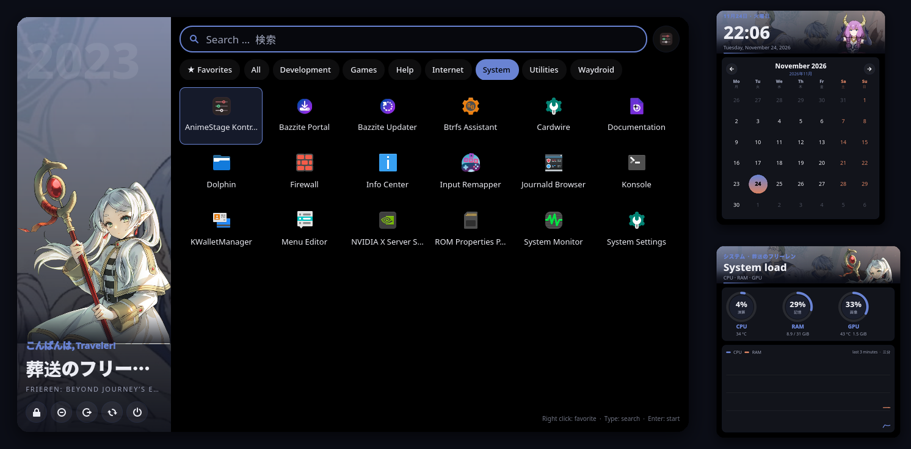

# AnimeStage

**KDE Plasma 6 のデスクトップを、好きなアニメの世界に。**
アニメのタイトルを入れるだけで、AnimeStage がデスクトップ全体をそのアニメに合わせて仕上げます。切り替わる壁紙、どこでも揃う色、スタートメニューのキャラクター、そしてターミナル・Firefox・VS Code まで同じ雰囲気に。

🌐 [English](../README.md) · [Deutsch](README.de.md) · **日本語** · [Français](README.fr.md) · [Español](README.es.md) · [Português (BR)](README.pt_BR.md) · [Italiano](README.it.md) · [Polski](README.pl.md) · [Nederlands](README.nl.md) · [Русский](README.ru.md) · [简体中文](README.zh_CN.md) · [繁體中文](README.zh_TW.md) · [한국어](README.ko.md)


## できること

- **どのアニメでも** – AniList で検索すると、タイトル・バナー・キャラクター（年齢つき）を自動で取得します。
- **切り替わる壁紙** – 2 時間ごと（変更可）に Konachan から新しい画像を取得。キャラクター・フィルター・雰囲気で選べます。気に入った画像はお気に入りに、合わない画像は除外できます。
- **色が壁紙に合わせて変わる** – 新しい画像ごとにアクセントカラーを取り出し、Plasma、ウィンドウ装飾、フォルダーアイコン（Papirus）、ターミナル、Firefox、VS Code に反映します。
- **アニメ風のパネル** – キャラクター入りのスタートメニュー、Windows のようにウィンドウ名が出るタスクバー、音楽プレーヤー、CPU／RAM／GPU のリング、カレンダー。
- **ターミナル** – テーマカラーの kitty または Konsole、新しい画像とシステム情報が出るあいさつ、Starship のプロンプト、背景画像も設定できます。
- **Firefox** – タブとアドレスバーを合う色に。新しいタブの画像は起動するたびに変わります。
- **ロック画面とログイン画面**にも同じ壁紙を表示します（ログイン画面：Plasma Login Manager）。
- **コントロールセンター** – すべて 1 つのウィンドウで設定でき、設定ファイルを触る必要はありません。
- **13 言語に対応** – システムの言語に合わせて表示され、コントロールセンターで切り替えられます。

### Windows のようなタスクバー


ウィンドウごとに、アイコンの横に名前のついたボタンが並びます。Firefox を 2 つ開けばボタンも 2 つです。ピン留めしたアプリは置いた場所から動かず、ウィンドウもその場所に開きます。**コントロールセンター → 外観 → タスクバー** で、名前の非表示、ウィンドウのグループ化、幅（狭い／ふつう／広い）を設定できます。

### 壁紙と色


壁紙が変わると色も変わります。AnimeStage が画像からアクセントカラーと背景色を取り出し、パネル、ウィンドウ、アイコン、ターミナル、Firefox、VS Code を塗り替えます – 2 時間ごとに自動で。各画像の下のパネルは、その画像から取った色です。

### スタートメニュー、カレンダー、システム負荷



| コントロールセンター – アニメとキャラクター | コントロールセンター – 壁紙 |
|---|---|
|  |  |

## 動作環境

- **KDE Plasma 6**（Bazzite / Fedora Atomic と Plasma 6.8 で開発・テスト。Plasma 6 を使うほかのディストリビューションでも動くはずです）
- **Pillow** 入りの Python 3（`python3-pillow`）
- インターネット接続（AniList、Konachan、Danbooru）
- 任意：kitty（希望すれば自動でインストール）、Starship／eza／bat／zoxide 用の Homebrew、Kvantum

すべてユーザープロファイル内にインストールされるので、**root 権限は不要**です。ログイン画面の壁紙を設定するときだけ、一度パスワードを聞かれます。

## インストール

**かんたんな方法（おすすめ）：**

1. [最新リリース](https://github.com/propanisen/AnimeStage/releases/latest)から **AnimeStage.zip** をダウンロードします。
2. 展開します（右クリック → *ここに展開*）。
3. フォルダー内の **AnimeStage をインストール** をダブルクリックし、画面の案内に従います。言語、パネル、アニメを選べば完了です。

**ターミナルで 1 行：**

```bash
curl -fsSL https://github.com/propanisen/AnimeStage/releases/latest/download/get.sh | bash
```

**git を使う（開発者向け）：**

```bash
git clone https://github.com/propanisen/AnimeStage.git
cd AnimeStage
./install.sh --plan          # 何をするかを表示（何も変更しません）
./install.sh                 # インストール（先に KDE 設定をバックアップします）
```

オプション：

```bash
./install.sh --anime "Frieren"   # 最初からこのアニメで始める
./install.sh --lang ja           # インストーラーとテーマの言語
./install.sh --profile core      # 今のパネルをそのまま使う
```

インストールしたら **スタートメニュー → AnimeStage コントロールセンター → アニメ** を開き、好きなアニメを検索してください。

### アップデート

AnimeStage は 1 日 1 回 GitHub で新しいバージョンを確認し、見つかると通知でお知らせします。**今すぐインストール** を押せばワンクリックで完了です。**コントロールセンター → システム → Updates** や `animestage update install` からでもインストールできます。同じ場所で「自動でインストール」にすることもできます。アップデートの前には毎回バックアップを作成します。確認が不要なら、そこで「オフ」にするか `animestage update off` を実行してください。

git クローンから手動で更新する場合：

```bash
git pull
./update.sh          # 設定・お気に入り・パネルはそのままです
```

### アンインストール

**かんたんな方法：** コントロールセンター → システム → **AnimeStage をアンインストール…** – 確認のウィンドウが出て、すべて元に戻します。

**ターミナルで：**

```bash
./uninstall.sh            # すべて削除し、元の KDE 設定に戻す
./uninstall.sh --purge    # ダウンロードした画像と設定ファイルも削除する
```

**インストールとアンインストールで何が起きるか：** インストーラーは何かを変更する前に、KDE の設定（パネル、色、ウィンドウ装飾、フォント、ロック画面、スプラッシュ画面など）を `~/.local/state/animestage/backups/original` に保存します。アンインストールすると、AnimeStage のファイルとタイマーをすべて削除し、ターミナル・Firefox・VS Code・ログイン画面の変更を元に戻したうえで、このバックアップを復元します。デスクトップはインストール前とまったく同じ状態に戻ります。インストール後にパネルを変更していた場合、その変更も元に戻ります。バックアップ自体は残ります。

## コンテンツフィルター

AnimeStage は **最初から全年齢向け** の設定です（フィルター「厳しめ」）。

- **SFW** では、そのアニメのすべてのキャラクターを表示します。
- **Ecchi／NSFW** はオンにできますが、表示するのは **成人キャラクターだけ** です。年齢は AniList の情報（18 歳以上）か、自分で指定したものに限ります。自分で指定できるのは、AniList に年齢がないか「1000+」のような設定上の年齢しかない場合だけです。AniList で未成年とされるキャラクターは、どうやっても解除できません。
- 露出のある画像は、ほかのキャラクターが写っておらず、若く見えることを示すタグもない場合にだけ使います。
- **ロック画面・ログイン画面・ターミナル・Firefox には、常に「safe」の画像だけを表示します。**
- これらのルールはセルフテストで確認しています。ルールが削除・緩和されていると、インストーラーはインストールを中止します。

**女性キャラクターだけ** を表示することもできます（コントロールセンター → アニメ）。

## コマンドライン

```bash
animestage search frieren            # AniList で検索
animestage anime 154587 --apply      # このアニメを使う
animestage wall next | fav | ban     # 次の壁紙／お気に入りに保存／もう表示しない
animestage set wallswitch.minutes 60 # 切り替え間隔
animestage themed new terminal --tags "night, city"   # ターミナル背景を自分で検索
animestage source check              # 画像サイトにつながるか確認
animestage status
animestage --help
```

## 画像の取得元と追加方法

画像の検索とダウンロードは、すべて 1 つのファイルにまとまっています：[`lib/animestage_sources.py`](../lib/animestage_sources.py)。
サイトがつながらなくなったときや別のサイトを使いたいときは、そこに追加（`SOURCES` と `PURPOSES`）して `./update.sh` を実行してください。コントロールセンターの **システム → 画像の取得元** で選べるようになります。Moebooru（Konachan、yande.re）、Danbooru、Gelbooru 系のサイト用のアダプターを用意しています。

## 翻訳

翻訳ファイルは [`i18n/`](../i18n/) にあります。言語ごとに 1 つの JSON ファイルです（ドイツ語の原文 → 翻訳）。
`tools/i18n-extract.py` で未翻訳の文を確認できます。修正や新しい言語の追加は大歓迎です！

## クレジット

- アニメ情報：[AniList](https://anilist.co) · 壁紙：[Konachan](https://konachan.net) · 切り抜き：[Danbooru](https://danbooru.donmai.us)（AI 画像は禁止されています）
- フォント：[M PLUS Rounded 1c](https://fonts.google.com/specimen/M+PLUS+Rounded+1c)（SIL OFL） · アイコン：[Papirus](https://github.com/PapirusDevelopmentTeam/papirus-icon-theme)（GPL-3.0）
- AnimeStage 自体にアニメの画像は含まれていません。画像はアニメを選んだときにダウンロードされます。作者はコントロールセンターで確認できます（画像にマウスを乗せてください）。キャラクターの権利は各権利者に帰属します。非営利のファンプロジェクトで、上記のサービスとは関係ありません。

**propanisen** が **Claude Opus 5.5**（Anthropic）と一緒に作りました。デザイン、コード、翻訳は AI との対話の中で生まれました。

## ライセンス

[GPL-3.0](../LICENSE)
