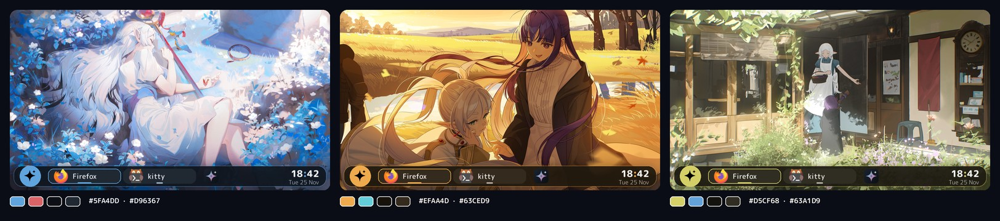

# AnimeStage

**Transforme seu desktop KDE Plasma 6 no seu anime favorito.**
Digite um anime – o AnimeStage monta o desktop inteiro em volta dele: papéis de parede que trocam, cores combinando em tudo, personagens no menu iniciar e terminal, Firefox e VS Code no tema.

🌐 [English](../README.md) · [Deutsch](README.de.md) · [日本語](README.ja.md) · [Français](README.fr.md) · [Español](README.es.md) · **Português (BR)** · [Italiano](README.it.md) · [Polski](README.pl.md) · [Nederlands](README.nl.md) · [Русский](README.ru.md) · [简体中文](README.zh_CN.md) · [繁體中文](README.zh_TW.md) · [한국어](README.ko.md)


## Recursos

- **Qualquer anime** – busca pelo AniList; título, banner e personagens (com idade) vêm automaticamente.
- **Papéis de parede que trocam** – imagens novas do Konachan a cada 2 horas (ajustável), por personagem, filtro e clima. Salve favoritos ou descarte imagens.
- **As cores seguem o papel de parede** – as cores de destaque de cada imagem nova vão para o Plasma, decoração das janelas, ícones (pastas Papirus), terminal, Firefox e VS Code.
- **Painel estilo anime** – menu iniciar com recorte do personagem, gerenciador de tarefas com títulos das janelas, pílula de música, anéis de CPU/RAM/GPU e calendário.
- **Terminal** – kitty ou Konsole nas cores do tema, saudação com uma imagem nova + info do sistema, prompt Starship e, se quiser, uma imagem de fundo no terminal.
- **Firefox** – abas e barra de endereço combinando, mais uma imagem na nova aba que muda a cada abertura.
- **Tela de bloqueio e de login** também mostram seu papel de parede (login: Plasma Login Manager).
- **Central de controle** – tudo em uma janela, sem editar arquivos de configuração.
- **13 idiomas** – segue o idioma do sistema e pode ser trocado na Central de controle.

### Barra de tarefas como no Windows


Cada janela ganha sua própria entrada com o título ao lado do ícone – duas janelas do Firefox são duas entradas. Os aplicativos fixados ficam onde você os colocou, e suas janelas abrem ali mesmo. Em **Central de controle → Aparência → Gerenciador de tarefas** você pode ocultar os títulos, agrupar janelas ou escolher a largura (estreita / média / larga).

### Papéis de parede e cores



Cada papel de parede novo traz suas próprias cores: o AnimeStage tira as cores de destaque e de fundo da imagem e recolore o painel, as janelas, os ícones, o terminal, o Firefox e o VS Code – automaticamente a cada 2 horas. O painel na parte de baixo de cada imagem mostra as cores daquela imagem.

### Menu iniciar, calendário e uso do sistema


| Central de controle – anime e personagens | Central de controle – papel de parede |
|---|---|
|  |  |

## Requisitos

- **KDE Plasma 6** (feito e testado no Bazzite / Fedora Atomic com Plasma 6.8; outras distribuições com Plasma 6 devem funcionar)
- Python 3 com **Pillow** (`python3-pillow`)
- Conexão com a internet (AniList, Konachan, Danbooru)
- Opcional: kitty (instalado automaticamente se você quiser), Homebrew para Starship/eza/bat/zoxide, Kvantum

Tudo é instalado no seu perfil de usuário – **sem precisar de root**. Só o papel de parede da tela de login pede sua senha uma vez.

## Instalação

**O jeito fácil (recomendado):**

1. Baixe o **AnimeStage.zip** da [versão mais recente](https://github.com/propanisen/AnimeStage/releases/latest).
2. Extraia (clique direito → *Extrair aqui*).
3. Dê um clique duplo em **Instalar o AnimeStage** na pasta e siga as janelas: idioma, painel, anime – pronto.

**Uma linha no terminal:**

```bash
curl -fsSL https://github.com/propanisen/AnimeStage/releases/latest/download/get.sh | bash
```

**Com git (para desenvolvedores):**

```bash
git clone https://github.com/propanisen/AnimeStage.git
cd AnimeStage
./install.sh --plan          # mostra o que vai acontecer (não muda nada)
./install.sh                 # instalar (antes é feito um backup das suas configurações do KDE)
```

Opções:

```bash
./install.sh --anime "Frieren"   # começar direto com um anime
./install.sh --lang pt_BR        # idioma do instalador e do tema
./install.sh --profile core      # manter seu painel atual
```

Depois abra **Menu iniciar → Central de controle do AnimeStage → Anime** e busque seu anime.

### Atualizar

O AnimeStage verifica uma vez por dia no GitHub se há uma nova versão e mostra uma notificação. Instale com um clique em **Central de controle → Sistema → Updates** (ou `animestage update install`). A notificação tem um botão **Instalar agora** – ou deixe as atualizações se instalarem sozinhas (configuração no mesmo lugar). Antes de cada atualização é feito um backup. Não quer a verificação? Desmarque lá ou rode `animestage update off`.

Atualizar manualmente a partir de um clone git:

```bash
git pull
./update.sh          # suas configurações, favoritos e painel continuam como estão
```

### Desinstalar

**O jeito fácil:** Central de controle → Sistema → **Desinstalar o AnimeStage …** – uma janela pergunta antes e restaura tudo.

**No terminal:**

```bash
./uninstall.sh            # remove tudo e restaura suas configurações originais do KDE
./uninstall.sh --purge    # também apaga as imagens baixadas e a configuração
```

**O que acontece na instalação e na desinstalação:** antes de mudar qualquer coisa, o instalador salva suas configurações do KDE (painel, cores, decoração das janelas, fontes, tela de bloqueio, tela de abertura …) em `~/.local/state/animestage/backups/original`. A desinstalação remove todos os arquivos e timers do AnimeStage, desfaz as mudanças no terminal, Firefox, VS Code e tela de login e depois restaura esse backup – sua área de trabalho fica exatamente como antes. Mudanças no painel feitas depois da instalação também são desfeitas. Os backups em si são mantidos.

## Filtro de conteúdo

O AnimeStage é **livre para todos por padrão** (filtro “Rígido”).

- **SFW** mostra todos os personagens do anime.
- **Ecchi / NSFW** pode ser ativado, mas **só mostra personagens adultos**: a idade precisa vir do AniList (18+), ou você marca o personagem – o que só é possível se o AniList não informar idade ou informar uma idade fantástica como “1000+”. Personagens menores de idade segundo o AniList nunca podem ser liberados.
- Imagens ousadas só são usadas se não houver outro personagem na imagem e nenhuma tag indicar alguém mais jovem.
- **Tela de bloqueio, tela de login, terminal e Firefox sempre mostram só imagens “safe”.**
- Um autoteste verifica essas regras; o instalador se recusa a instalar se elas foram removidas ou enfraquecidas.

Você também pode mostrar **só personagens femininas** (Central de controle → Anime).

## Linha de comando

```bash
animestage search frieren            # busca no AniList
animestage anime 154587 --apply      # usar um anime
animestage wall next | fav | ban     # próximo papel de parede, salvar como favorito, nunca mais mostrar
animestage set wallswitch.minutes 60 # intervalo de troca
animestage themed new terminal --tags "night, city"   # busca própria para o fundo do terminal
animestage source check              # os sites de imagens estão acessíveis?
animestage status
animestage --help
```

## Fontes de imagens e como adicionar as suas

Toda a busca e o download de imagens ficam em um só arquivo: [`lib/animestage_sources.py`](../lib/animestage_sources.py).
Se um site cair ou você quiser outro, adicione-o ali (`SOURCES` e `PURPOSES`) e rode `./update.sh` – ele aparece na Central de controle em **Sistema → Fontes de imagens**. Existem adaptadores prontos para Moebooru (Konachan, yande.re), Danbooru e sites do tipo Gelbooru.

## Traduções

As traduções ficam em [`i18n/`](../i18n/) – um arquivo JSON por idioma, texto original em alemão → tradução.
`tools/i18n-extract.py` lista os textos que faltam. Correções e novos idiomas são muito bem-vindos!

## Créditos

- Dados de anime: [AniList](https://anilist.co) · Papéis de parede: [Konachan](https://konachan.net) · Recortes: [Danbooru](https://danbooru.donmai.us) (imagens de IA são proibidas lá)
- Fonte: [M PLUS Rounded 1c](https://fonts.google.com/specimen/M+PLUS+Rounded+1c) (SIL OFL) · Ícones: [Papirus](https://github.com/PapirusDevelopmentTeam/papirus-icon-theme) (GPL-3.0)
- O AnimeStage não inclui imagens de anime – tudo é baixado quando você escolhe um anime. Os artistas aparecem na Central de controle (passe o mouse sobre uma imagem). Todos os personagens © de seus detentores. Projeto de fã sem fins comerciais, sem vínculo com os serviços acima.

Feito por **propanisen** junto com o **Claude Opus 5.5** (Anthropic) – design, código e traduções foram criados em conversa com a IA.

## Licença

[GPL-3.0](../LICENSE)
