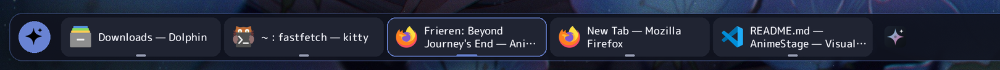
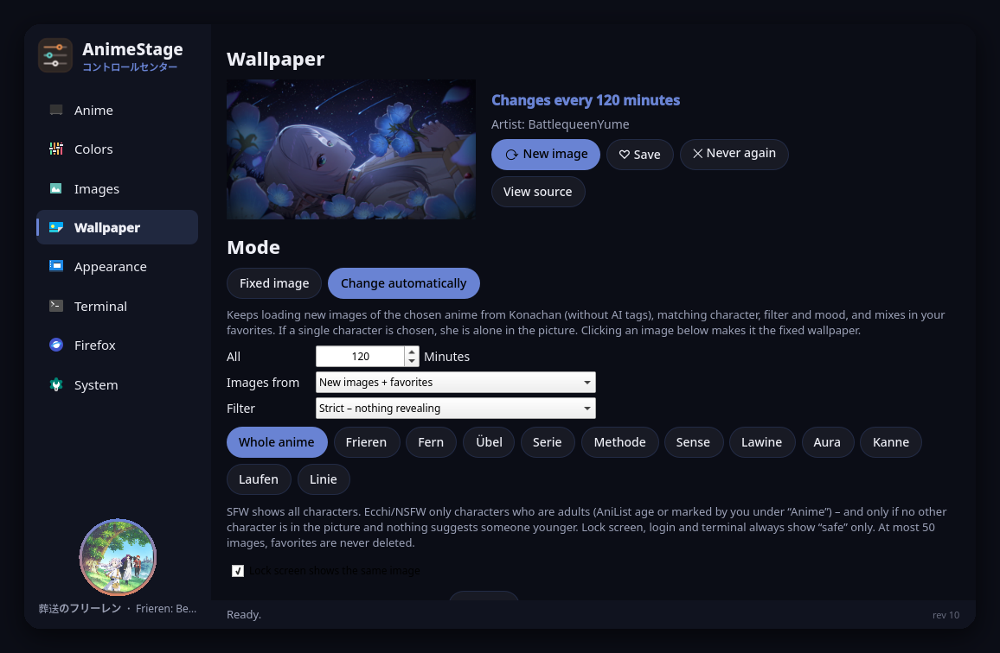

# AnimeStage

**让你的 KDE Plasma 6 桌面变成最爱动漫的样子。**
输入一部动漫，AnimeStage 就会围绕它布置整个桌面：自动轮换的壁纸、处处协调的配色、开始菜单里的角色，连终端、Firefox 和 VS Code 也换成同样的风格。

🌐 [English](../README.md) · [Deutsch](README.de.md) · [日本語](README.ja.md) · [Français](README.fr.md) · [Español](README.es.md) · [Português (BR)](README.pt_BR.md) · [Italiano](README.it.md) · [Polski](README.pl.md) · [Nederlands](README.nl.md) · [Русский](README.ru.md) · **简体中文** · [繁體中文](README.zh_TW.md) · [한국어](README.ko.md)


## 功能

- **什么动漫都行** – 通过 AniList 搜索，标题、横幅和角色（含年龄）都会自动获取。
- **自动轮换壁纸** – 每 2 小时（可调）从 Konachan 获取新图片，可按角色、过滤和氛围挑选。喜欢的可以收藏，不喜欢的可以排除。
- **配色跟着壁纸走** – 从每张新图片中提取强调色，应用到 Plasma、窗口装饰、文件夹图标（Papirus）、终端、Firefox 和 VS Code。
- **动漫风格的面板** – 带角色的开始菜单、像 Windows 一样显示窗口标题的任务栏、音乐播放器、CPU/内存/GPU 圆环和日历。
- **终端** – 主题配色的 kitty 或 Konsole，带新图片和系统信息的问候语，Starship 提示符，还可以设置背景图片。
- **Firefox** – 标签页和地址栏使用相配的颜色，每次启动时新标签页都会换一张图片。
- **锁屏和登录界面**也会显示你的壁纸（登录界面：Plasma Login Manager）。
- **控制中心** – 所有设置都在一个窗口里完成，不用改配置文件。
- **支持 13 种语言** – 跟随系统语言，也可以在控制中心切换。

### 像 Windows 一样的任务栏



每个窗口都有自己的按钮，图标旁显示标题——开两个 Firefox 窗口就有两个按钮。固定的应用会留在你放的位置，窗口也在那里打开。在 **控制中心 → 外观 → 任务栏** 中可以隐藏标题、合并窗口或选择宽度（窄 / 中 / 宽）。

### 壁纸与配色


每张新壁纸都会带来自己的配色：AnimeStage 从图片中提取强调色和背景色，重新为面板、窗口、图标、终端、Firefox 和 VS Code 着色——每 2 小时自动进行。每张图片底部的面板显示的就是从这张图片提取的颜色。

### 开始菜单、日历和系统负载


| 控制中心 – 动漫与角色 | 控制中心 – 壁纸 |
|---|---|
|  |  |

## 系统要求

- **KDE Plasma 6**（在 Bazzite / Fedora Atomic + Plasma 6.8 上开发和测试；其他使用 Plasma 6 的发行版应该也能用）
- 带 **Pillow** 的 Python 3（`python3-pillow`）
- 网络连接（AniList、Konachan、Danbooru）
- 可选：kitty（需要时可自动安装）、用于 Starship/eza/bat/zoxide 的 Homebrew、Kvantum

所有内容都安装在你的用户目录中——**不需要 root 权限**。只有设置登录界面壁纸时需要输入一次密码。

## 安装

**最简单的方法（推荐）：**

1. 从[最新版本](https://github.com/propanisen/AnimeStage/releases/latest)下载 **AnimeStage.zip**。
2. 解压（右键 → *解压到此处*）。
3. 在文件夹中双击 **安装 AnimeStage**，按窗口提示操作：选择语言、面板和动漫，就完成了。

**终端里一行命令：**

```bash
curl -fsSL https://github.com/propanisen/AnimeStage/releases/latest/download/get.sh | bash
```

**使用 git（开发者）：**

```bash
git clone https://github.com/propanisen/AnimeStage.git
cd AnimeStage
./install.sh --plan          # 显示将要做什么（不做任何更改）
./install.sh                 # 安装（会先备份你的 KDE 设置）
```

选项：

```bash
./install.sh --anime "Frieren"   # 直接从某部动漫开始
./install.sh --lang zh_CN        # 安装程序和主题的语言
./install.sh --profile core      # 保留现在的面板
```

然后打开 **开始菜单 → AnimeStage 控制中心 → 动漫**，搜索你喜欢的动漫。

### 更新

AnimeStage 每天会在 GitHub 上检查一次是否有新版本，并通过通知提醒你。点一下 **立即安装** 就行——也可以在 **控制中心 → 系统 → Updates** 中安装，或运行 `animestage update install`。在那里还可以设置为自动安装更新。每次更新前都会先备份。不想检查更新？在那里选“关闭”，或运行 `animestage update off`。

从 git 克隆手动更新：

```bash
git pull
./update.sh          # 你的设置、收藏和面板保持不变
```

### 卸载

**最简单的方法：** 控制中心 → 系统 → **卸载 AnimeStage…**——会先弹出窗口确认，然后恢复一切。

**在终端中：**

```bash
./uninstall.sh            # 删除全部内容并恢复原来的 KDE 设置
./uninstall.sh --purge    # 同时删除下载的图片和配置
```

**安装和卸载时会发生什么：** 在做任何更改之前，安装程序会把你的 KDE 设置（面板、颜色、窗口装饰、字体、锁屏、启动画面…）保存到 `~/.local/state/animestage/backups/original`。卸载时会删除所有 AnimeStage 文件和定时器，撤销对终端、Firefox、VS Code 和登录界面的更改，然后恢复这份备份——桌面会和安装前完全一样。安装后对面板做的修改也会被还原。备份本身会保留。

## 内容过滤

AnimeStage **默认是全年龄的**（过滤为“严格”）。

- **SFW** 显示这部动漫的所有角色。
- **Ecchi / NSFW** 可以开启，但**只会显示成年角色**：年龄必须来自 AniList（18 岁以上），或由你自己标记——只有当 AniList 没有年龄、或只有“1000+”这类幻想年龄时才能标记。AniList 中未成年的角色永远无法解锁。
- 只有当图片中没有其他角色、也没有任何标签暗示更年轻的人时，才会使用暴露的图片。
- **锁屏、登录界面、终端和 Firefox 始终只显示“safe”图片。**
- 这些规则由自检程序检查；如果规则被删除或削弱，安装程序会拒绝安装。

你也可以设置为**只显示女性角色**（控制中心 → 动漫）。

## 命令行

```bash
animestage search frieren            # 在 AniList 搜索
animestage anime 154587 --apply      # 使用某部动漫
animestage wall next | fav | ban     # 下一张壁纸 / 收藏 / 不再显示
animestage set wallswitch.minutes 60 # 轮换间隔
animestage themed new terminal --tags "night, city"   # 自定义搜索终端背景
animestage source check              # 图片网站能否访问？
animestage status
animestage --help
```

## 图片来源与添加自己的来源

所有图片的搜索和下载都集中在一个文件中：[`lib/animestage_sources.py`](../lib/animestage_sources.py)。
如果某个网站无法访问，或者你想换一个，在那里添加（`SOURCES` 和 `PURPOSES`），然后运行 `./update.sh`——它就会出现在控制中心的 **系统 → 图片来源** 里。已经为 Moebooru（Konachan、yande.re）、Danbooru 和 Gelbooru 类网站准备好了适配器。

## 翻译

翻译文件位于 [`i18n/`](../i18n/)——每种语言一个 JSON 文件（德语原文 → 译文）。
`tools/i18n-extract.py` 会列出缺少的文本。欢迎改进翻译或添加新语言！

## 致谢

- 动漫资料：[AniList](https://anilist.co) · 壁纸：[Konachan](https://konachan.net) · 抠图：[Danbooru](https://danbooru.donmai.us)（该站禁止 AI 生成的图片）
- 字体：[M PLUS Rounded 1c](https://fonts.google.com/specimen/M+PLUS+Rounded+1c)（SIL OFL） · 图标：[Papirus](https://github.com/PapirusDevelopmentTeam/papirus-icon-theme)（GPL-3.0）
- AnimeStage 本身不包含任何动漫图片——所有图片都在你选择动漫后才下载。作者信息显示在控制中心（把鼠标移到图片上）。所有角色版权归各自权利人所有。这是一个非商业的粉丝项目，与上述服务无关。

由 **propanisen** 与 **Claude Opus 5.5**（Anthropic）共同制作——设计、代码和翻译都是在与 AI 的对话中完成的。

## 许可证

[GPL-3.0](../LICENSE)
